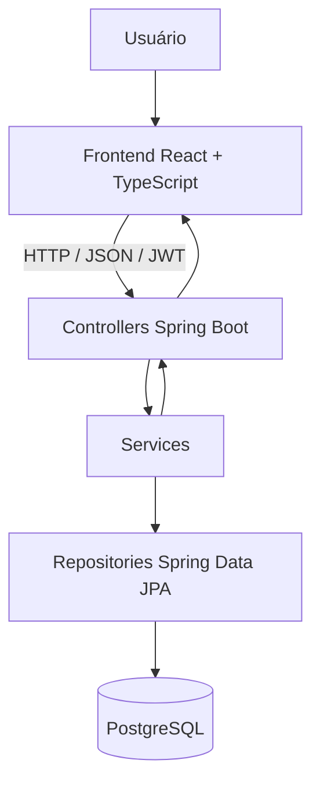

# 💰 FinanceControl

Aplicação web de controle financeiro pessoal desenvolvida para ajudar usuários a organizar suas finanças, acompanhar receitas e despesas, visualizar seu saldo e planejar objetivos financeiros.

O projeto utiliza uma arquitetura separada entre frontend e backend, com uma API REST desenvolvida em Java e Spring Boot, persistência em PostgreSQL e autenticação baseada em JWT.

## 📌 Sumário

- [Sobre o projeto](#-sobre-o-projeto)
- [Funcionalidades](#-funcionalidades)
- [Tecnologias utilizadas](#-tecnologias-utilizadas)
- [Arquitetura](#-arquitetura)
- [Demonstração](#-demonstração)
- [Pré-requisitos](#-pré-requisitos)
- [Como executar localmente](#-como-executar-localmente)
- [Variáveis de ambiente](#-variáveis-de-ambiente)
- [Autenticação e segurança](#-autenticação-e-segurança)
- [Principais endpoints](#-principais-endpoints)
- [Banco de dados](#-banco-de-dados)
- [Docker](#-docker)
- [Testes](#-testes)
- [Deploy](#-deploy)
- [Melhorias futuras](#-melhorias-futuras)

## 🎯 Sobre o projeto

O FinanceControl nasceu com o objetivo de facilitar o gerenciamento das finanças pessoais por meio de uma interface intuitiva e de uma API REST responsável pelo processamento e armazenamento dos dados.

A aplicação permite registrar movimentações financeiras, acompanhar o saldo, organizar metas de economia e visualizar informações que auxiliam no planejamento financeiro.

O desenvolvimento também envolve conceitos importantes de engenharia de software, como autenticação, autorização, validação de dados, persistência relacional, separação de responsabilidades e containerização.

## ✨ Funcionalidades

### 👤 Usuários e autenticação

- Cadastro de usuários.
- Login com email e senha.
- Autenticação por JSON Web Token (JWT).
- Proteção de rotas privadas.
- Integração entre frontend e API autenticada.

### 💸 Controle financeiro

- Cadastro de receitas e despesas.
- Consulta de registros financeiros.
- Organização das movimentações.
- Atualização do saldo conforme as movimentações realizadas.

### 🎯 Cofres e metas financeiras

- Criação de cofres para objetivos financeiros.
- Definição do nome e da meta de cada cofre.
- Registro de aportes financeiros.
- Acompanhamento do valor acumulado em cada meta.

### 📊 Interface e visualização

- Dashboard financeiro.
- Visualização de informações e indicadores.
- Gráficos e componentes de resumo financeiro.
- Interface adaptável a diferentes tamanhos de tela.
- Páginas de login, cadastro, registros, cofres e perfil.

## 🛠️ Tecnologias utilizadas

### Backend

| Tecnologia | Utilização |
|---|---|
| Java | Linguagem de programação |
| Spring Boot | Estrutura principal da aplicação |
| Spring Web | Criação de endpoints REST |
| Spring Data JPA | Persistência e acesso a dados |
| Hibernate | Mapeamento objeto-relacional |
| Spring Security | Segurança e proteção dos endpoints |
| JWT | Autenticação baseada em tokens |
| Bean Validation | Validação de dados, quando aplicada |
| Maven | Gerenciamento de dependências e build |
| PostgreSQL | Banco de dados relacional |

### Frontend

| Tecnologia | Utilização |
|---|---|
| React | Construção da interface |
| TypeScript | Tipagem estática |
| Vite | Desenvolvimento e build |
| React Router | Navegação entre páginas |
| CSS | Estilização e responsividade |
| Fetch API | Comunicação com o backend |

### Infraestrutura

- Docker para containerização.
- Docker Compose para orquestração dos serviços locais.
- Render para hospedagem do backend.
- Vercel para hospedagem do frontend.

## 🏗️ Arquitetura

O projeto separa a interface de usuário da API responsável pelas regras de negócio e pela persistência.



### Responsabilidades das camadas

- **Frontend:** apresenta as telas, coleta dados e consome os endpoints da API.
- **Controllers:** recebem requisições HTTP e coordenam as operações solicitadas.
- **Services:** concentram as regras de negócio.
- **Repositories:** realizam as operações de persistência.
- **Entities:** representam os dados persistidos no banco.
- **DTOs:** definem os dados recebidos e devolvidos pela API.
- **Security:** valida os tokens e controla o acesso às rotas protegidas.

## 🌐 Demonstração

- **Aplicação web:** https://finance-control-springboot.vercel.app/
- **Repositório do backend:** https://github.com/rodrigoreisrsz/finance-control-springboot
- **API hospedada:** https://controle-financeiro-pessoal-wpzz.onrender.com

A disponibilidade dos serviços depende do estado dos ambientes de hospedagem.

## 📋 Pré-requisitos

Para executar o projeto localmente, tenha instalado:

- Git.
- Java e JDK compatíveis com a configuração do projeto.
- Maven ou o Maven Wrapper, caso esteja disponível.
- Node.js e npm.
- Docker e Docker Compose, para executar a infraestrutura em containers.
- PostgreSQL, caso prefira executar o banco fora do Docker.

## 🚀 Como executar localmente

O frontend e o backend podem ser executados separadamente durante o desenvolvimento.

### 1. Clonar o repositório

```bash
git clone https://github.com/rodrigoreisrsz/finance-control-springboot.git
cd finance-control-springboot
```

### 2. Configurar e executar o backend

Entre no diretório do backend, onde está o arquivo `pom.xml`.

Configure as variáveis de ambiente necessárias para a conexão com o PostgreSQL e para a geração dos tokens JWT.

Se o Maven estiver instalado:

```bash
mvn spring-boot:run
```

Se o projeto possuir Maven Wrapper, utilize o comando correspondente ao seu sistema operacional:

```bash
./mvnw spring-boot:run
```

No Windows:

```powershell
.\mvnw.cmd spring-boot:run
```

A porta padrão configurada para a aplicação é `8080`, salvo se a variável `PORT` definir outra porta.

### 3. Configurar e executar o frontend

Entre no diretório do frontend, onde está o `package.json`.

Instale as dependências:

```bash
npm install
```

Crie o arquivo `.env` na raiz do frontend e configure a URL da API:

```env
VITE_API_URL=http://localhost:8080
```

Inicie o servidor de desenvolvimento:

```bash
npm run dev
```

O Vite exibirá no terminal o endereço local para abrir a aplicação no navegador.

### 4. Gerar a versão de produção do frontend

```bash
npm run build
```

Para executar a verificação de tipos, caso o script esteja configurado no projeto:

```bash
npx tsc --noEmit
```

## ⚙️ Variáveis de ambiente

As credenciais e configurações sensíveis devem ser fornecidas por variáveis de ambiente, sem serem incluídas no código-fonte.

### Backend

Exemplo de configuração:

```env
SPRING_DATASOURCE_URL=jdbc:postgresql://localhost:5432/FinanceiroNovo
SPRING_DATASOURCE_USERNAME=postgres
SPRING_DATASOURCE_PASSWORD=sua_senha_local

JWT_SECRET=defina_uma_chave_secreta_forte
JWT_EXPIRATION_MS=7200000

CORS_ALLOWED_ORIGINS=http://localhost:5173
PORT=8080
```

As variáveis devem corresponder aos nomes utilizados pela configuração Spring Boot. Em ambientes Docker, o endereço do banco pode ser diferente de `localhost`.

### Frontend

```env
VITE_API_URL=http://localhost:8080
```

Em produção, `VITE_API_URL` deve apontar para a URL pública do backend.

No Vite, as variáveis com prefixo `VITE_` são incorporadas ao código disponibilizado ao navegador. Portanto, não armazene senhas, segredos JWT ou credenciais privadas nessas variáveis.

## 🔐 Autenticação e segurança

A aplicação utiliza JWT para autenticar as requisições à API.

### Fluxo de autenticação

1. O usuário realiza o cadastro ou envia suas credenciais para o login.
2. O backend valida as credenciais.
3. Após a autenticação bem-sucedida, a API retorna os dados de acesso, incluindo o token JWT.
4. O frontend armazena o token durante a sessão.
5. As requisições a endpoints protegidos enviam o token no cabeçalho HTTP `Authorization`.

Exemplo:

```http
Authorization: Bearer SEU_TOKEN_JWT
```

### Regras de autorização

A proteção dos dados pessoais deve assegurar que:

- Endpoints privados exijam autenticação válida.
- Cada usuário consulte somente os próprios registros e cofres.
- A busca, edição e exclusão de recursos verifiquem a propriedade do recurso.
- A criação de recursos associe o usuário autenticado no backend, sem confiar em um `userId` enviado pelo cliente.
- A criação ou exclusão de aportes valide se o cofre relacionado pertence ao usuário autenticado.
- Operações não autorizadas não modifiquem registros, saldos, cofres ou aportes.

Essas regras devem ser verificadas por testes de integração e autorização, além de testes manuais com contas diferentes.

## 🔌 Principais endpoints

Os endpoints abaixo refletem as rotas principais conhecidas da aplicação. Os métodos de atualização e exclusão devem ser confirmados nos controllers antes de utilizar esta lista como contrato definitivo da API.

| Método | Endpoint | Descrição |
|---|---|---|
| POST | `/user` | Cadastro de usuário |
| POST | `/user/login` | Login e autenticação |
| GET | `/registros` | Consulta de registros financeiros |
| GET | `/cofre` | Consulta de cofres |
| GET | `/cofre/{id}` | Consulta de um cofre |
| POST | `/cofre` | Criação de cofre |
| POST | `/cofre/aportes` | Registro de aporte em um cofre |

Os endpoints privados devem ser chamados com um token JWT válido.

### Exemplo de login

```http
POST /user/login
Content-Type: application/json
```

O corpo da requisição deve seguir os campos definidos pelo DTO de login da API, normalmente email e senha.

### Exemplo de criação de aporte

```http
POST /cofre/aportes
Content-Type: application/json
Authorization: Bearer SEU_TOKEN_JWT
```

```json
{
  "cofreId": 1,
  "valor": 250.00,
  "data": "2026-10-15"
}
```

O exemplo utiliza um cofre existente e uma data no formato ISO `AAAA-MM-DD`.

## 🗄️ Banco de dados

O PostgreSQL é utilizado para persistir os dados da aplicação.

Entre as principais entidades de domínio estão:

- **User:** representa o usuário.
- **Registro:** representa uma movimentação financeira.
- **Cofre:** representa uma meta financeira.
- **Aporte:** representa uma contribuição para um cofre.

As entidades são mapeadas por meio do JPA/Hibernate e acessadas pela camada de repositórios.

### Acessar o PostgreSQL com Docker

Para listar os containers em execução:

```bash
docker ps
```

Para abrir o `psql` dentro do container do banco, substitua o nome do container pelo correspondente no seu ambiente:

```bash
docker exec -it NOME_DO_CONTAINER psql -U postgres -d FinanceiroNovo
```

Se a aplicação estiver em outro container conectado à mesma rede Docker, utilize o nome do serviço do banco como hostname. A partir do computador host, utilize `localhost` e a porta publicada pelo Docker.

## 🐳 Docker

O Docker pode ser utilizado para executar o PostgreSQL e o backend em containers.

Se o repositório possuir um `docker-compose.yml` configurado, valide-o antes de iniciar os serviços:

```bash
docker compose config
```

Suba os serviços:

```bash
docker compose up -d
```

Consulte o estado dos containers:

```bash
docker compose ps
```

Acompanhe os logs:

```bash
docker compose logs -f
```

Para encerrar os serviços sem remover os volumes:

```bash
docker compose down
```

O nome da rede, os nomes dos serviços, as portas e as variáveis de ambiente devem corresponder ao arquivo Compose utilizado no ambiente.

## 🧪 Testes

O backend utiliza Maven para executar a suíte de testes configurada no projeto.

Para executar os testes:

```bash
mvn test
```

Ou, com o Maven Wrapper:

```bash
./mvnw test
```

No Windows:

```powershell
.\mvnw.cmd test
```

Os testes devem verificar, conforme a cobertura implementada:

- Cadastro e autenticação de usuários.
- Validação de credenciais.
- Proteção dos endpoints privados.
- Isolamento dos dados entre usuários.
- Propriedade dos registros e cofres.
- Regras de criação e exclusão de aportes.
- Atualização correta dos saldos.
- Comportamento diante de requisições não autorizadas.

## ☁️ Deploy

### Frontend — Vercel

O frontend está hospedado em:

https://finance-control-springboot.vercel.app/

A variável de ambiente de produção deve apontar para o backend:

```env
VITE_API_URL=https://controle-financeiro-pessoal-wpzz.onrender.com
```

Após modificar variáveis de ambiente do Vite na Vercel, gere um novo deploy para que os valores sejam incorporados ao build.

### Backend — Render

O backend está hospedado em:

https://controle-financeiro-pessoal-wpzz.onrender.com

Configure no ambiente de produção as variáveis necessárias para:

- URL, usuário e senha do banco PostgreSQL.
- Segredo JWT e tempo de expiração.
- Origens permitidas para CORS.
- Porta fornecida pelo ambiente de hospedagem, quando aplicável.

A origem permitida para o frontend deve corresponder à URL publicada na Vercel:

```env
CORS_ALLOWED_ORIGINS=https://finance-control-springboot.vercel.app
```

Não publique credenciais do banco, segredos JWT ou arquivos `.env` com dados reais no repositório.

## 🛠️ Solução de problemas

### Erro de CORS

Confira se `CORS_ALLOWED_ORIGINS` contém a origem exata do frontend, incluindo o protocolo `https://`. Verifique também se as requisições `OPTIONS` são permitidas pela configuração de segurança.

### Erro 401 — Unauthorized

Confira se as credenciais estão corretas, se o login retorna um token válido e se o frontend envia o cabeçalho `Authorization: Bearer ...` nas requisições privadas.

### Erro 403 — Forbidden

Verifique as regras do Spring Security, a configuração dos filtros JWT e as verificações de propriedade do recurso. Um `403` pode indicar uma restrição de autorização; não significa necessariamente que o token esteja ausente.

### Erro de conexão com o PostgreSQL no Docker

Confira se o banco está em execução, se a porta está publicada e se a API e o banco compartilham a rede Docker correta. Entre containers, `localhost` aponta para o próprio container, não para o container do PostgreSQL.

### Falha no build ou nos testes

Verifique a versão do Java exigida pelo `pom.xml`, as variáveis de ambiente e os logs completos do Maven. Se o contexto Spring falhar ao iniciar, procure a primeira ocorrência de `Caused by` para identificar a causa original.

## 🗺️ Melhorias futuras

Possíveis evoluções do projeto incluem:

- Expansão da cobertura de testes automatizados.
- Aprimoramento do tratamento padronizado de erros.
- Melhorias contínuas de acessibilidade e responsividade.
- Evolução dos relatórios e gráficos financeiros.
- Paginação e filtros para consultas com muitos registros.
- Documentação interativa da API, caso seja adicionada ao backend.
- Pipeline de integração contínua para build e testes.

## 👨‍💻 Autor

**Rodrigo Reis**

- GitHub: https://github.com/rodrigoreisrsz

---

Projeto desenvolvido para praticar e consolidar conhecimentos em desenvolvimento web, APIs REST, Java, Spring Boot, React, TypeScript, PostgreSQL, autenticação JWT e Docker.
